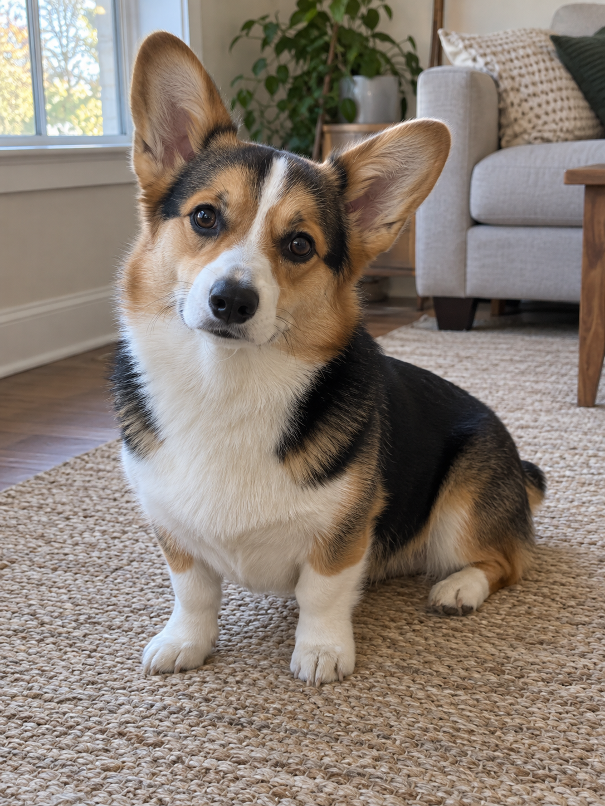
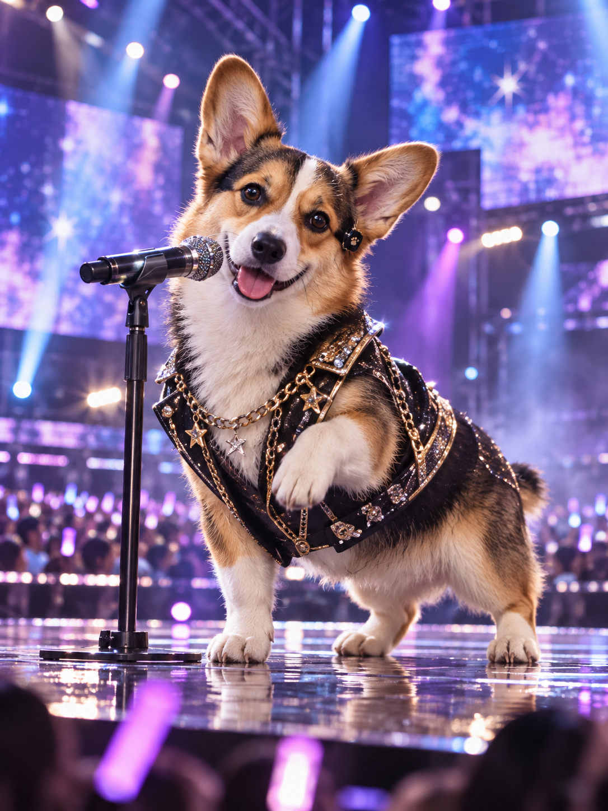

# 공연 중인 K-pop 아이돌 — v2 등록 검토

사용자가 반려동물 확장을 요청한 뒤 가상 코기 원본과 v2 결과를 보고 “결과 확정·PR 제출”을 선택했다. 승인 범위는 해당 문구·코기 예시의 Draft PR 제출이다.

| AI 가상 원본 | v2 변환 결과 |
| --- | --- |
|  |  |

[실제 적용 문구 v2](kpop-stage-performance-prompt-v2.txt) · [생성 입력·자산 치수·해시 기록](image-generation-2026-10-23-kpop-stage-performance.json)

원본 한 장과 공개 문구만 내장 image_gen에 전달했다. 추가 사진별 지시·후편집은 없으며, 공개 원본·결과는 무손실 WebP로 변환한 뒤 디코딩 픽셀의 일치를 확인했다. 썸네일은 결과 비율을 유지해 축소했다.

큰 귀, 눈과 주둥이의 인상, 얼굴의 흰 세로 무늬와 삼색 털, 흰 앞발이 알아보기 쉽게 유지됐다. 동물 앞발과 체형을 유지한 채 무대 베스트·낮은 스탠드 마이크·한쪽 앞발 제스처·LED 무대·응원봉이 표현됐다. 의상이 등 무늬를 가리고 원본에서 꼬리가 대부분 가려져 해당 세부는 비교하기 어렵다.

공개 예시는 가상 코기 한 마리의 1회 시험이다. v2 인물 분기·고양이·다른 품종·단체 사진은 미시험이다. 이전 인물 결과는 사람 전용 v1을 적용했으므로 이번 v2 예시로 등록하지 않았다. 특정 얼굴·품종·여러 피사체에 대한 반복 생성 품질을 보장하지 않는다.

카탈로그 ID: kpop-stage-performance; order: -46. 기존 항목과 상대 순서는 보존했다.
