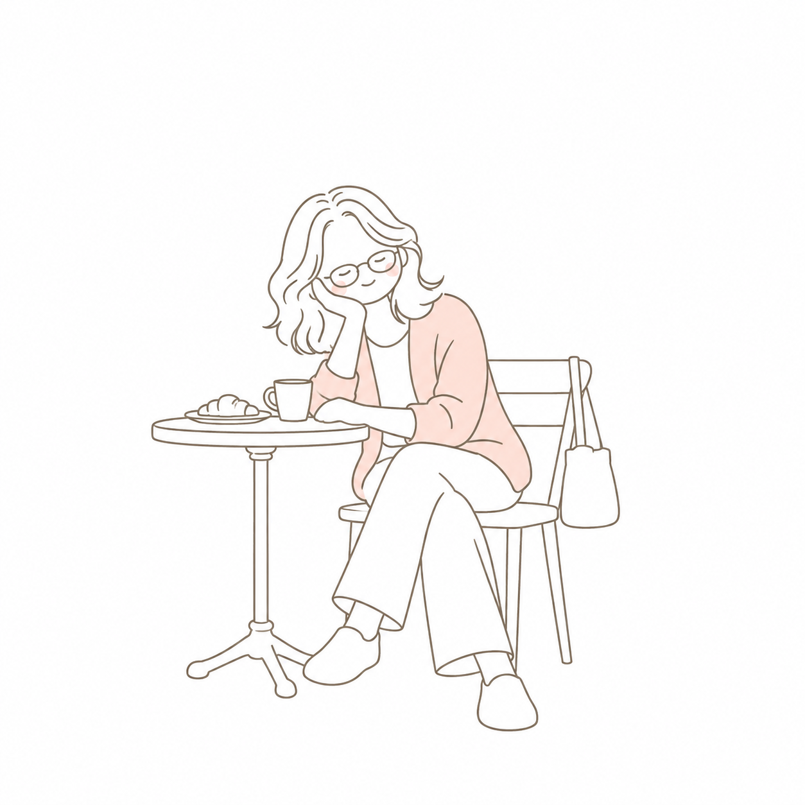
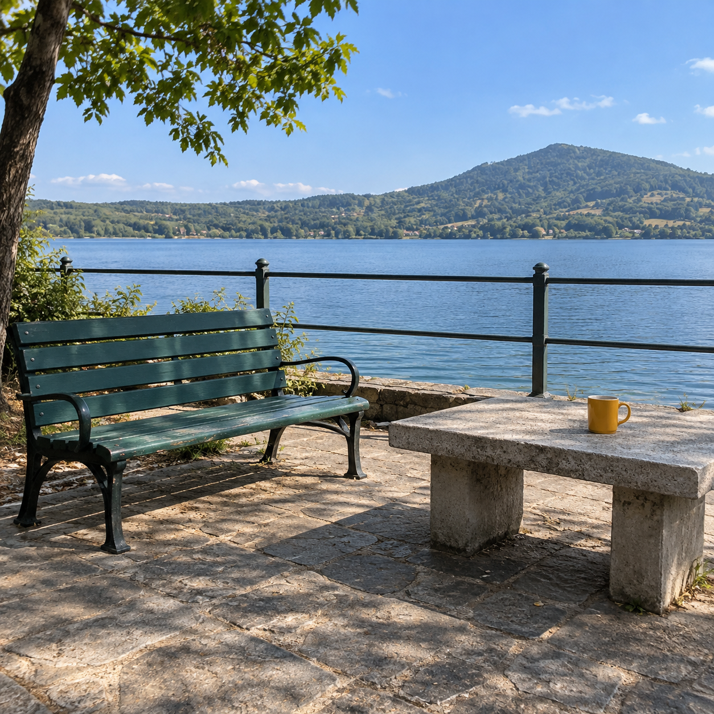
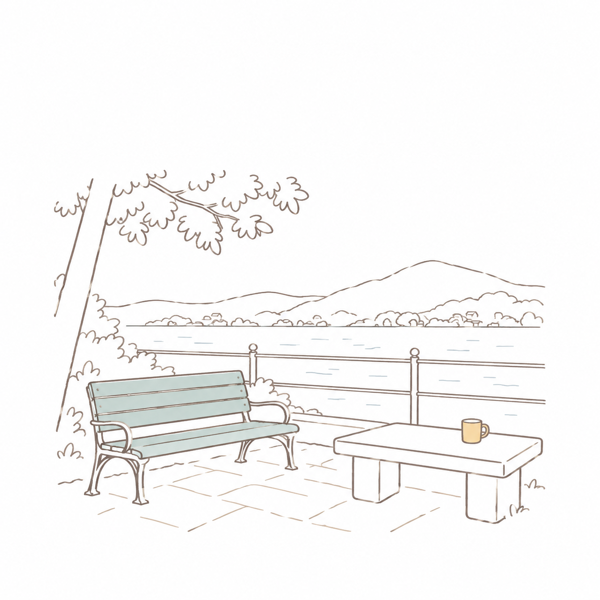
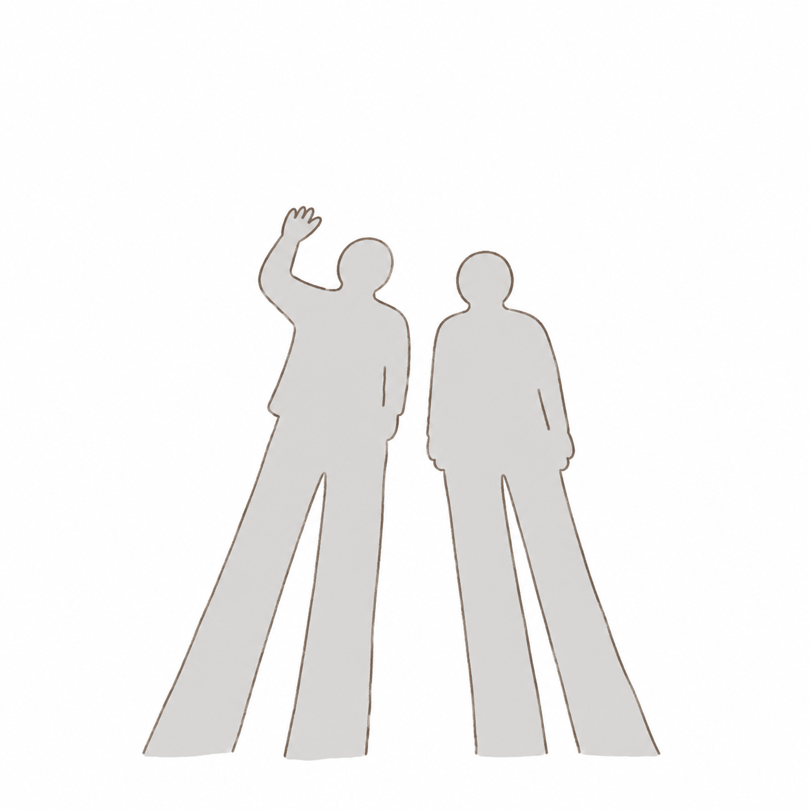

# 부분 채색 라인드로잉 v10 개선 검토 — 2026-10-31

## 변경 결과와 승인
사람이 없는 입력에 사람이 생기거나, 그림자에 얼굴이 붙고 원본에 없는 형태가 추가되는 문제를 줄이도록 기존 v5를 v10으로 수정했다. 인물·풍경·그림자를 같은 문구로 시험했다. 손가락은 둥근 외곽으로 단순화하고 여분·가려진 손가락을 만들지 않도록 지시한다.

v7의 세밀한 묘사 때문에 아기자기함이 줄었다는 피드백을 반영해 둥근 형태·짧은 표정선·볼 포인트를 복원했다. 사용자는 v11/v12보다 v10 인물·풍경 결과를 선호했고, v10 원문을 받아 직접 시험할 수 있게 제공한 뒤 **“좋다 이거 PR해줘 머지는 내가할게”**라고 요청했다. 등록·검증·PR 제출까지가 승인 범위이며 병합·운영 배포는 수행하지 않는다.

- 기존 항목: spot-color-line-art. ID·제목·order·기존 기여자 표기를 유지한다.
- 원본/head 저장소: Q07K/prompt-gallery, origin
- 브랜치: codex/spot-color-line-art-fidelity
- 기준 커밋: b879bab1b199806d4a5797b93805e854cec2e5c5. 기존 관리 작업 공간을 재사용했고 제출 직전 origin/main과 일치함을 확인했다.
- [공개 v10 실제 문구](spot-color-line-art-prompt-v10.txt)
- [실제 입력·원본 생성 문구·출력 식별자·치수·SHA-256·픽셀 검증](image-generation-2026-10-31-spot-color-line-art-v10.json)

## 원본과 v10 결과
인물은 공개 v5의 AI 가상 원본을 재사용했고, 풍경·그림자는 이번 작업 중 만든 AI 가상 사진이다. 사용자 스타일 참고 그림은 눈으로만 참고했으며 최종 도구 입력·공개 자산에 넣지 않았다. 각 시험은 원본 한 장과 공개 v10 원문만 사용했다. 추가 지시·스타일 첨부·후편집은 없다.

| 예시 | AI 가상 입력 | 같은 v10 문구의 출력 |
|---|---|---|
| 인물 |  |  |
| 사람 없는 풍경 |  |  |
| 사람 그림자 |  |  |

## 관찰과 남은 차이
- 인물: 한 명·안경·턱을 괸 자세·교차한 다리·카디건과 컵·테이블·의자의 관계가 남고 얼굴·손발이 둥글게 단순화됐다. 컵 손잡이는 원본처럼 한쪽에만 보인다. 원본의 빵·가방은 생략 지시와 달리 남았고 가구 디자인·비례·머리 선 수·미세 색조도 요청과 차이가 있다.
- 풍경: 사람이 새로 생기지 않았고 벤치·컵·테이블·난간·호수의 관계를 유지했다. 벤치·컵에 각각 색이 남고 물에도 옅은 색 선이 있어 **한 군데 채색 조건은 완전히 지키지 않았다**. 사용자는 더 엄격하게 단색화한 v11보다 이 v10 결과를 선호했다. 원문은 변경하지 않고 실제 차이를 예시 설명에 적었다.
- 그림자: 두 그림자와 손 든 동작이 남고 얼굴·머리카락·의상이나 별도의 실물 사람은 추가되지 않았다. 잘린 끝을 새 발 모양으로 완성하지 않았다. 팔 주변 내부선·회색 농담과 손가락 외곽·실루엣 비율 차이는 남았다.
- 손가락은 생략된 형태다. 정확한 개수나 간헐적 오류 감소율은 검증하지 않았고 모든 입력에서 보존을 보장하지 않는다. 동물·다인·다른 조명·뒷모습은 별도로 시험하지 않았다.
- 각 결과는 이번 시각 검토의 관찰이며 완전한 원본 복제·지정 선 개수·정확한 구도 비율 준수를 주장하지 않는다.

## 등록과 보존
- 기존 64개 항목 중 이 항목만 갱신했다. 다른 63개 내용·모든 ID·order·상대 순서를 보존했다.
- inputRequirement를 portrait에서 image로 바꾸고 인물·풍경·그림자 예시를 연결했다. 첫 인물 예시는 기존 카드·썸네일·대표 원본과 일치한다.
- 선택된 결과와 새 원본은 크롭·보정 없이 무손실 WebP로 변환했다. 인물 원본은 기존 WebP를 그대로 재사용했다. 6개 원본/결과의 디코딩 RGBA 픽셀이 입력 파일과 일치한다. 썸네일만 비율을 유지해 480×480으로 축소했다.
- 비공개 시험 출력·사용자 첨부 그림·v6~v9/v11/v12 초안은 PR에 포함하지 않는다.
- v5 검토 문서의 결과 이미지는 v5 커밋에 고정해 현재 v10을 과거 결과로 오인하지 않게 했다.

## 검증
- npm ci와 Chromium 설치 완료.
- npm run check -- -- --global-timeout=900000: 단위 검사 34개와 64개 상세 페이지 빌드 통과. 브라우저 검사 초회 65/66 통과, 데스크톱 전체 카드 이미지 로딩 한 건은 기본 30초 제한 초과로 실패.
- npm run test:e2e -- --last-failed --project=desktop-chromium --global-timeout=900000: 실패한 동일 검사 1개가 8.4초에 통과. 검사 항목·worker·개별 제한을 바꾸지 않았고 초회 이력을 숨기지 않았다. 전체 66개 시나리오는 최초 실행과 해당 재실행을 합쳐 모두 통과했다.
- 이번 항목의 3개 예시 전환·원본 연결·다운로드·문구 유지·복사는 데스크톱과 모바일 모두 초회 통과.
- 실행 전체 예산만 15분으로 지정했으며 저장소 테스트 설정·CI 설정은 변경하지 않았다.
- 공개 문구와 실제 v10 입력 일치, 3개 예시 원본·결과·설명 연결, 무손실 6개 픽셀 일치, 썸네일 치수, 나머지 63개 항목과 전체 ID·order·상대 순서 보존, 문서 링크·개인 경로 제외·Git 공백 검사 확인.

## 제출 범위
사용자가 직접 병합한다. 이 PR 제출 작업에서 main 병합이나 Cloudflare Pages 운영 배포를 실행하지 않는다. 미병합 브랜치와 작업 자료는 후속 수정용으로 보존한다.
