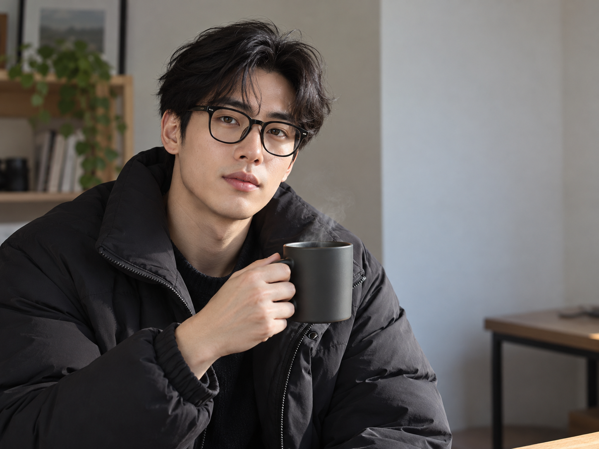
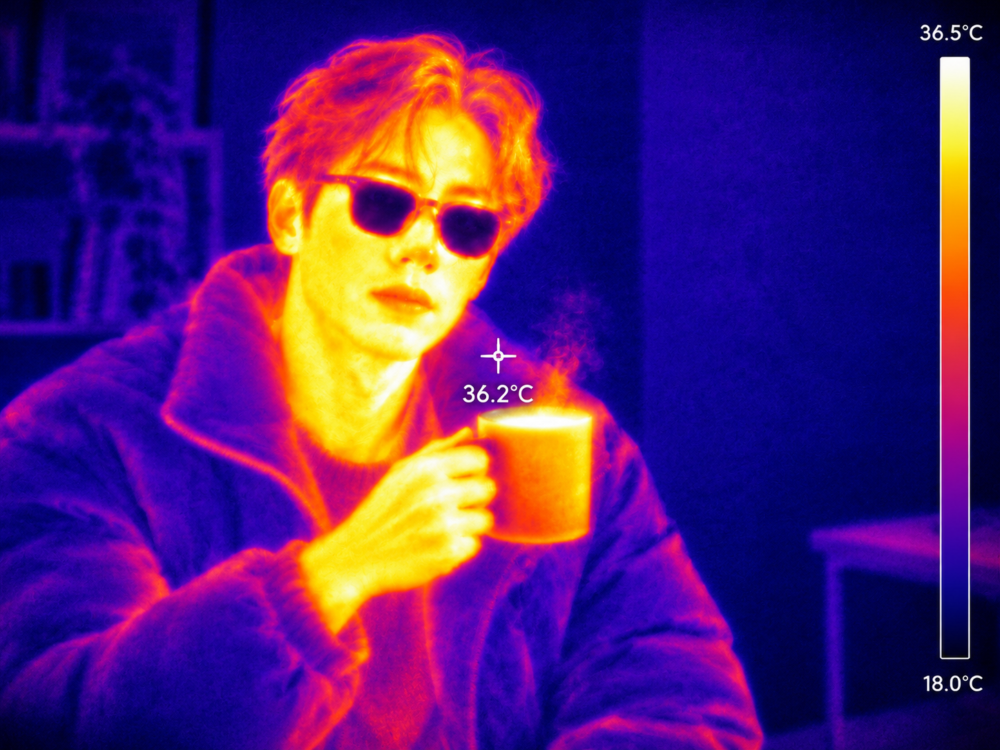

# 열화상 카메라 v1 예시 검토

AI 가상 성인 원본 한 장에 [공개 v1 문구](image-generation-2026-10-26-thermal-camera.json)만 적용했다. 스타일 참고 이미지·추가 지시·후편집은 없었다.

| AI 가상 원본 | 열화상 변환 결과 |
|---|---|
|  |  |

원본의 한 인물, 상반신 구도, 안경과 컵을 든 자세가 유지됐다. 아이언 팔레트와 차가운 배경, 밝은 얼굴·손·컵, 어두운 렌즈 덕분에 열화상 화면으로 읽힌다. 오른쪽 온도 막대와 가운데 조준선이 있으며 `36.5°C`, `18.0°C`, `36.2°C`를 읽을 수 있다. 이 숫자는 이미지에 생성된 표기이며 실제 측정값이 아니다.

머리카락이 주황·노랑으로 과하게 뜨겁게 표현됐다. 옷 주름과 얼굴 경계는 요청한 저해상도 열화상보다 선명하다. 다른 인물이나 휴대폰 사진은 시험하지 않았다.

원본 생성 문구, 실제 변환 문구, 생성 파일명과 해시, 자산 크기는 [생성 기록](image-generation-2026-10-26-thermal-camera.json)에 있다.
